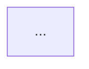

# Prompt untuk Membuat Gambar/Diagram Akademik Proposal Disertasi

Gunakan file ini sebagai prompt utama di ChatGPT untuk menyusun semua gambar, diagram, dan visual akademik yang dibutuhkan dalam proposal penelitian.

Lampirkan proposal revisi ketika memakai prompt ini:

- `Proposal_Disertasi_23032026.docx`

Jika ChatGPT tidak dapat membaca proposal, minta ChatGPT berhenti dan meminta file proposal diunggah ulang. Jangan menyusun gambar tanpa membaca konteks proposal.

---

## Prompt Utama

Anda adalah desainer visual akademik, ahli metodologi penelitian pendidikan vokasi, ahli kurikulum berbasis kompetensi, ahli DACUM, dan ahli visualisasi sistem AI/NLP.

Saya melampirkan proposal disertasi berjudul:

**"Pengembangan Sistem Rekomendasi Kompetensi Bidang Rekayasa Perangkat Lunak Berdasarkan Analisis Kebutuhan Pasar Tenaga Kerja"**

Tugas Anda adalah membaca proposal secara menyeluruh, lalu menyusun **paket gambar/diagram akademik yang dibutuhkan dalam proposal**. Gambar harus mendukung pemahaman proposal, bukan menjadi dekorasi. Setiap gambar harus relevan dengan bagian proposal, memiliki judul/caption akademik, dan dapat dipakai dalam dokumen disertasi/proposal.

---

## Prinsip Visual

Gunakan gaya akademik, formal, bersih, dan mudah dibaca:

1. gunakan gaya diagram ilmiah, bukan gaya poster promosi;
2. hindari ilustrasi kartun, 3D, maskot, foto stok, ornamen, gradient berlebihan, dan dekorasi yang tidak bermakna;
3. gunakan warna terbatas: biru tua, abu-abu, putih, hitam, dan satu warna aksen secukupnya;
4. gunakan font sans-serif akademik seperti Arial, Calibri, Aptos, Inter, atau Source Sans;
5. gunakan struktur visual yang konsisten antar-gambar;
6. pastikan semua teks besar dan terbaca saat dicetak di A4;
7. gunakan panah, blok proses, swimlane, matriks, dan layered architecture jika sesuai;
8. setiap gambar harus bisa direkonstruksi dalam Mermaid, PowerPoint, draw.io, Figma, atau SVG;
9. untuk gambar yang mengandung banyak teks, utamakan diagram berbasis teks/vektor seperti Mermaid atau SVG, bukan image generator bebas, karena image generator sering merusak teks kecil;
10. jangan membuat gambar yang terlihat seperti infografis media sosial.

---

## Aturan Keras Arah Panah dan Domain

Gambar yang dihasilkan sebelumnya sering salah karena arah panah dan domain terlalu bebas. Karena itu, semua gambar harus mengikuti aturan berikut.

### A. Aturan Arah Panah

1. **Alur data/proses selalu kiri ke kanan**.
   - Contoh benar: `Lowongan kerja -> Persiapan kalimat -> Ekstraksi bukti -> Klaster tema -> Pernyataan kompetensi -> Validasi ahli -> Rekomendasi kurikulum`.
   - Jangan membalik arah panah dari rekomendasi ke data mentah.

2. **Alur keputusan/gate boleh atas ke bawah**.
   - Contoh: `Korpus valid? -> Bukti cukup? -> Relevan RPL/TI? -> Validasi ahli lulus?`.

3. **Panah putus-putus hanya untuk umpan balik/revisi**.
   - Contoh: `Masukan ahli -. revisi .-> Pernyataan kompetensi`.
   - Jangan pakai panah putus-putus untuk alur data utama.

4. **Panah dua arah dilarang kecuali dijelaskan eksplisit**.
   - Hampir semua hubungan dalam proposal ini bersifat alur, gate, atau validasi, bukan hubungan bolak-balik.

5. **Dashboard tidak boleh memiliki panah yang membuatnya tampak sebagai sumber validitas**.
   - Dashboard hanya menampilkan evidence package, audit, dan hasil rekomendasi.
   - Dashboard boleh menerima feedback pengguna, tetapi feedback itu masuk ke proses review/revisi, bukan langsung mengubah rekomendasi.

6. **LLM tidak boleh langsung menunjuk ke "rekomendasi kurikulum final"**.
   - LLM hanya boleh menunjuk ke `draft`, `ekstraksi`, `ringkasan bukti`, atau `bantuan perumusan`.
   - Setelah itu harus melewati `grounding/audit` dan `validasi ahli`.

7. **Korpus US/non-Indonesia tidak boleh memiliki panah menuju `official_ready`**.
   - Jalurnya harus berhenti di `engineering validation`, `exploratory`, atau maksimal `review_candidate`.

8. **Korpus Indonesia hanya boleh menuju klaim kurikulum setelah melewati audit dan validasi ahli**.
   - Jalur benar: `Korpus Indonesia -> Audit validitas korpus -> Pipeline evidence-first -> Validasi ahli -> Review candidate -> Official ready jika syarat terpenuhi`.

### B. Batas Domain Visual

Gunakan batas domain/lane yang jelas. Jangan mencampur semua komponen dalam satu kotak besar.

Domain yang disarankan:

1. **Domain Masalah dan Kebutuhan**
   - mismatch kompetensi;
   - kebutuhan kurikulum berbasis bukti;
   - kebutuhan pasar tenaga kerja.

2. **Domain Bukti Pasar Kerja**
   - lowongan kerja;
   - korpus;
   - kalimat requirement;
   - bukti tugas/kompetensi.

3. **Domain Pengolahan AI/NLP**
   - sentence preparation;
   - extraction;
   - post-extraction typing;
   - clustering;
   - evidence-bound drafting;
   - grounding check.

4. **Domain Kurikulum dan Okupasi**
   - CBET;
   - DACUM;
   - KKNI;
   - SKKNI;
   - Spektrum Keahlian;
   - competency statement.

5. **Domain Validasi Manusia**
   - ahli kurikulum;
   - praktisi industri;
   - ahli NLP/AI;
   - ahli evaluasi;
   - Delphi/expert panel.

6. **Domain Output**
   - evidence package;
   - recommendation status;
   - rekomendasi kompetensi;
   - coverage analysis;
   - bahan telaah kurikulum.

7. **Domain Antarmuka**
   - dashboard publik;
   - dashboard administratif;
   - worksheet review.

Jangan menempatkan `dashboard` di domain validasi. Dashboard adalah media antarmuka, bukan validator.

---

## Aturan Bahasa Label

Proposal ini untuk pembaca akademik pendidikan vokasi, bukan hanya pembaca teknis AI. Karena itu, label gambar harus memakai bahasa yang dapat dipahami ahli kurikulum.

### A. Gunakan Label Sederhana

Gunakan label seperti:

- "Lowongan kerja"
- "Bukti kebutuhan industri"
- "Persiapan kalimat"
- "Ekstraksi keterampilan dan pengetahuan"
- "Pengelompokan tema"
- "Pernyataan kompetensi"
- "Pemeriksaan bukti"
- "Validasi ahli"
- "Rekomendasi untuk telaah kurikulum"
- "Status rekomendasi"
- "Paket bukti"

### B. Hindari Label Terlalu Teknis pada Gambar Utama

Hindari memakai label utama seperti:

- `raw job CSV`;
- `Skill-LLM JSONL`;
- `Phase-1 evidence CSV`;
- `HDBSCAN`;
- `SBERT embedding`;
- `anti-hallucination filter`;
- `deduplication heuristic`;
- `OpenRouter`;
- `provider/model ablation`.

Istilah teknis boleh diletakkan sebagai sublabel kecil, catatan kaki gambar, atau gambar teknis di Bab III, tetapi jangan menjadi bahasa utama gambar konseptual.

### C. Padanan Label yang Disarankan

Gunakan padanan berikut:

| Istilah teknis | Label akademik yang disarankan |
|---|---|
| raw job CSV | Korpus lowongan kerja |
| prepared sentences | Kalimat lowongan yang diproses |
| Skill-LLM extraction | Ekstraksi keterampilan dan pengetahuan |
| post-extraction typing | Klasifikasi jenis bukti |
| clustering | Pengelompokan tema kompetensi |
| evidence-bound generation | Perumusan kompetensi berbasis bukti |
| grounding check | Pemeriksaan kesesuaian bukti |
| recommendation contract | Status kelayakan rekomendasi |
| evidence package | Paket bukti untuk review ahli |
| validation package | Paket validasi |
| dashboard | Antarmuka telaah |
| official_ready | Siap dipertimbangkan sebagai rekomendasi resmi |

---

## Prosedur Wajib Sebelum Membuat Gambar

Sebelum membuat gambar final atau prompt image generator, lakukan langkah berikut untuk setiap gambar:

1. Buat **tabel node dan domain**:

| Node | Domain | Peran | Masukan dari | Keluaran ke |
|---|---|---|---|---|

2. Buat **daftar panah eksplisit**:

| Dari | Ke | Jenis panah | Makna |
|---|---|---|---|

Jenis panah hanya boleh:

- `solid`: alur utama;
- `dashed`: revisi/umpan balik;
- `blocked`: jalur ditolak/tidak memenuhi syarat.

3. Buat **daftar larangan koneksi** untuk mencegah salah domain:

| Koneksi yang dilarang | Alasan |
|---|---|
| LLM -> Rekomendasi kurikulum final | Harus melewati audit dan validasi ahli |
| Korpus US -> official_ready | Korpus US hanya engineering validation |
| Dashboard -> Validitas rekomendasi | Dashboard hanya media telaah |

4. Baru setelah itu buat Mermaid/SVG/draw.io spec atau prompt image generator.

Jika tidak dapat membuat tabel node dan panah dengan jelas, jangan membuat gambar.

---

## Konteks Penelitian yang Harus Dipertahankan

Penelitian mengembangkan sistem rekomendasi kompetensi bidang Rekayasa Perangkat Lunak/Pengembangan Gim/Teknologi Informasi dengan pendekatan evidence-first.

Grand theory:

1. **Competency-Based Curriculum/CBET** sebagai teori utama format kompetensi.
2. **DACUM** sebagai kerangka pengembangan kurikulum vokasi.
3. Human Capital Theory dan Signaling Theory hanya teori pendukung.

Rantai pipeline:

`raw job CSV -> prepared sentences -> Skill-LLM extraction JSONL -> Phase-1 evidence CSV -> clustering -> cluster validity audit -> demand theme audit -> evidence-bound competency generation -> evidence repair -> deduplication -> KKNI/occupation/SKKNI/Spektrum mapping -> recommendation contract -> dashboard/evidence package/validation package`

Prinsip klaim:

1. Korpus US/non-Indonesia hanya untuk engineering validation.
2. Klaim kurikulum Indonesia harus memakai korpus Indonesia yang valid.
3. LLM bukan otoritas kurikulum.
4. Validasi ahli, evidence package, dan stability/ablation dibutuhkan sebelum klaim kuat.
5. Status rekomendasi: `exploratory`, `review_candidate`, `official_ready`.
6. Jika bukti lemah, sistem harus menyatakan `not_recommended_from_this_corpus`.

---

## Keluaran yang Diminta

Buat daftar gambar/diagram yang perlu masuk proposal. Untuk setiap gambar, berikan:

1. nomor gambar yang disarankan;
2. judul gambar;
3. lokasi penempatan dalam proposal, misalnya Bab I, Bab II, atau Bab III;
4. tujuan gambar;
5. pesan utama yang harus terbaca;
6. elemen visual yang harus ada;
7. layout yang disarankan;
8. caption akademik;
9. versi Mermaid jika cocok;
10. prompt image generator jika benar-benar perlu dibuat sebagai gambar visual;
11. catatan produksi, misalnya ukuran A4, rasio 16:9, atau orientasi landscape;
12. daftar teks label yang harus digunakan di gambar;
13. risiko salah interpretasi yang harus dihindari.

---

## Gambar Minimal yang Harus Dibuat

Susun minimal gambar berikut. Tambahkan gambar lain jika memang diperlukan oleh proposal.

Untuk gambar inti berikut, gunakan blueprint kanonik di bawah ini. Jangan mengubah arah panah kecuali ada alasan akademik yang dijelaskan.

### 1. Kerangka Konseptual Penelitian

Tampilkan hubungan antara:

- masalah mismatch kompetensi;
- sinyal pasar tenaga kerja dari lowongan kerja;
- CBET;
- DACUM;
- pipeline AI/NLP evidence-first;
- validasi ahli;
- rekomendasi kompetensi;
- pengembangan kurikulum RPL/TI.

Gambar harus menunjukkan bahwa AI/NLP membantu mengolah bukti, tetapi keputusan kurikulum tetap melalui validasi manusia.

**Blueprint panah wajib:**

`Mismatch kompetensi -> Kebutuhan rekomendasi berbasis bukti -> Bukti pasar kerja -> Pipeline evidence-first -> Paket bukti -> Validasi ahli -> Rekomendasi kompetensi untuk telaah kurikulum`

CBET dan DACUM harus menjadi fondasi/kerangka yang memberi kriteria pada `Pernyataan kompetensi`, bukan hasil dari pipeline.

Gunakan dua panah vertikal:

- `CBET -> Kriteria pernyataan kompetensi`
- `DACUM -> Struktur occupation-duty-task-skill-knowledge`

Keduanya masuk ke proses `Perumusan dan validasi kompetensi`.

**Koneksi yang dilarang:**

- `LLM -> Rekomendasi kurikulum final`
- `Dashboard -> Rekomendasi kompetensi`
- `US corpus -> Klaim kurikulum Indonesia`

### 2. Model Digital DACUM Berbasis Bukti Pasar Kerja

Tampilkan rantai:

`occupation/skema -> duty area -> task evidence -> hard skill/soft skill/knowledge -> competency statement -> curriculum recommendation`

Tegaskan bahwa lowongan kerja menjadi panel bukti awal, bukan pengganti expert worker.

**Blueprint panah wajib:**

`Okupasi RPL/TI -> Area tugas -> Bukti tugas dari lowongan -> Keterampilan/Pengetahuan/Sikap -> Pernyataan kompetensi -> Implikasi kurikulum`

Tambahkan gate validasi manusia:

`Ahli kurikulum dan praktisi industri -> Validasi area tugas, kompetensi, dan implikasi kurikulum`

Gunakan panah dari validasi ahli ke `Pernyataan kompetensi` dan `Implikasi kurikulum`, bukan ke data mentah.

### 3. Arsitektur Pipeline Evidence-First

Tampilkan seluruh alur pipeline dari raw job data sampai dashboard/evidence package:

- raw corpus ingestion;
- corpus lineage audit;
- sentence preparation;
- sentence relevance audit;
- Skill-LLM extraction;
- deterministic extraction typing;
- Phase-1 evidence;
- clustering;
- cluster validity audit;
- demand theme audit;
- competency generation;
- anti-hallucination/grounding;
- evidence repair;
- deduplication;
- KKNI/SKKNI/Spektrum/occupation mapping;
- recommendation contract;
- dashboard and validation package.

Gunakan flowchart horizontal atau layered pipeline.

**Blueprint sederhana untuk pembaca non-teknis:**

`Korpus lowongan kerja -> Audit validitas korpus -> Persiapan kalimat -> Ekstraksi bukti kompetensi -> Klasifikasi jenis bukti -> Pengelompokan tema -> Audit klaster -> Perumusan kompetensi berbasis bukti -> Pemeriksaan bukti -> Pemetaan KKNI/okupasi -> Status rekomendasi -> Paket bukti dan antarmuka telaah`

Istilah teknis seperti JSONL, CSV, HDBSCAN, SBERT, dan provider LLM jangan menjadi label utama. Boleh disebut dalam sublabel kecil jika diperlukan.

**Gate wajib:**

- `Audit validitas korpus` setelah korpus lowongan kerja.
- `Audit klaster` sebelum perumusan kompetensi.
- `Pemeriksaan bukti` setelah perumusan kompetensi.
- `Status rekomendasi` sebelum output dashboard/evidence package.

### 4. Data Lineage dan Corpus Validity Audit

Tampilkan bagaimana data ditelusuri dari:

- raw CSV;
- prepared dataset;
- sentence-filtered data;
- Skill-LLM input;
- Skill-LLM output;
- Phase-1 CSV;
- competency output.

Sertakan status:

- `valid_for_engineering_test`;
- `valid_for_indonesian_claim`;
- `invalid_or_incomplete`;
- `needs_manual_review`.

**Blueprint panah wajib:**

`Korpus mentah -> Dataset siap proses -> Kalimat yang dipertahankan -> Input ekstraksi -> Output ekstraksi -> Bukti Phase-1 -> Rekomendasi kompetensi`

Tambahkan audit samping yang memeriksa:

- jumlah pekerjaan;
- job_id overlap;
- bahasa/negara;
- tanggal;
- duplikasi;
- missing description;
- denominator.

Output audit hanya menuju `Status validitas korpus`, bukan langsung menuju rekomendasi.

### 5. Recommendation Contract dan Status Klaim

Tampilkan decision gate untuk:

- `exploratory`;
- `review_candidate`;
- `official_ready`;
- `not_recommended_from_this_corpus`.

Pastikan gambar menegaskan bahwa US corpus tidak dapat menghasilkan `official_ready`.

**Blueprint decision gate wajib:**

`Kompetensi kandidat`
-> `Lineage jelas?`
-> `Korpus sesuai klaim?`
-> `Bukti cukup dan grounded?`
-> `Relevan dengan RPL/TI?`
-> `Validasi ahli lulus?`
-> `Pemetaan resmi dan stabilitas lulus?`
-> `official_ready`

Cabang keputusan:

- Jika lineage tidak jelas: `exploratory`.
- Jika bukti tidak cukup: `not_recommended_from_this_corpus`.
- Jika tidak relevan RPL/TI: `out_of_domain_or_needs_review`.
- Jika validasi ahli belum lulus: `review_candidate`.
- Jika korpus US/non-Indonesia: maksimal `review_candidate`, tidak boleh lanjut ke `official_ready`.

### 6. Proses Ekstraksi Hard Skill, Soft Skill, dan Knowledge

Tampilkan alur:

- job sentence;
- span extraction;
- post-extraction typing;
- hard technical;
- technical process;
- soft skill;
- knowledge;
- credential;
- education requirement;
- personality trait;
- invalid fragment;
- out-of-domain.

Tunjukkan mana yang masuk clustering teknis dan mana yang dikeluarkan/didemote.

**Blueprint panah wajib:**

`Kalimat lowongan -> Kandidat span -> Klasifikasi jenis bukti`

Dari `Klasifikasi jenis bukti`, cabangkan ke:

- `Hard skill teknis -> Masuk klaster teknis`
- `Knowledge terkait -> Masuk bukti pengetahuan`
- `Technical process -> Masuk klaster proses teknis`
- `Soft skill -> Dipisahkan sebagai sinyal pendukung`
- `Credential/education -> Dipisahkan sebagai syarat pekerjaan`
- `Personality trait -> Dikeluarkan dari klaster teknis`
- `Invalid fragment -> Dikeluarkan`
- `Out-of-domain -> Audit out-of-domain`

Jangan menggambar soft skill sebagai hard skill.

### 7. Cluster Validity dan Demand Theme Audit

Tampilkan proses:

- candidate clusters;
- cluster validity audit;
- valid cluster;
- split required;
- mixed domain;
- support/process cluster;
- out-of-domain cluster;
- weak low-frequency theme;
- demand theme audit;
- generation allowed or blocked.

**Blueprint panah wajib:**

`Tema hasil pengelompokan -> Audit validitas klaster`

Dari audit validitas klaster, cabangkan ke:

- `Valid cluster -> Perumusan kompetensi`
- `Split required -> Pemecahan klaster`
- `Mixed domain -> Diblokir dari perumusan`
- `Support/process cluster -> Daftar proses/pendukung`
- `Out-of-domain cluster -> Audit out-of-domain`
- `Weak low-frequency theme -> Not recommended from this corpus`

Tambahkan `Demand theme audit` sebagai pemeriksaan setelah audit klaster, bukan sebagai sumber kompetensi langsung.

### 8. Kompetensi sebagai Output CBET

Tampilkan struktur competency statement:

- action verb;
- work object;
- context/condition;
- performance criterion;
- related hard skills;
- related knowledge;
- related soft skills;
- Bloom level;
- KKNI level;
- evidence bundle.

**Blueprint struktur wajib:**

Gunakan diagram radial atau stacked card dengan pusat:

`Pernyataan kompetensi`

Elemen pendukung:

- `Tindakan kerja`;
- `Objek kerja`;
- `Konteks/kondisi`;
- `Kriteria performa`;
- `Bukti lowongan`;
- `Hard skill`;
- `Knowledge`;
- `Soft skill pendukung`;
- `Bloom/KKNI`;
- `Okupasi/SKKNI/Spektrum`.

Panah dari semua elemen menuju `Pernyataan kompetensi`, lalu dari `Pernyataan kompetensi` menuju `Telaah kurikulum`.

Jangan membuat tools seperti Python/SQL sebagai kompetensi langsung. Tools harus menjadi bukti/unsur pendukung.

### 9. Kerangka Evaluasi dan Validasi Berlapis

Tampilkan lapisan evaluasi:

- corpus validity;
- sentence relevance;
- extraction quality;
- cluster validity;
- competency validity;
- KKNI/SKKNI/Spektrum mapping;
- ranking validity;
- dashboard usability;
- expert review;
- Delphi/expert panel;
- stability and ablation.

### 10. Rancangan Penelitian Borg and Gall dengan Agile Development

Tampilkan relasi:

- tahap Borg and Gall sebagai kerangka penelitian R&D;
- agile development sebagai proses teknis iteratif;
- validasi ahli dan uji coba sebagai titik keputusan.

Jangan membuatnya terlalu ramai. Gunakan swimlane jika perlu.

**Blueprint wajib:**

Gunakan dua lane:

1. `Kerangka penelitian R&D Borg and Gall`
2. `Pengembangan teknis Agile`

Panah utama Borg and Gall:

`Research and information collecting -> Planning -> Develop preliminary product -> Preliminary field testing -> Main product revision -> Main field testing -> Operational product revision -> Operational field testing -> Final product revision -> Dissemination`

Lane Agile berada di bawah tahap pengembangan produk dan revisi:

`build -> test -> review -> revise`

Hubungkan agile sebagai proses internal, bukan sebagai pengganti Borg and Gall.

### 11. Arsitektur Dashboard dan Evidence Package

Tampilkan komponen:

- dashboard administratif;
- dashboard publik;
- evidence package;
- validation package;
- DACUM/CBET worksheet;
- coverage analyzer;
- audit reports;
- user/stakeholder.

Tegaskan bahwa dashboard adalah media telaah, bukan sumber kebenaran.

### 12. Alur Validasi Ahli dan Delphi

Tampilkan:

- expert review packet;
- validator ahli kurikulum;
- praktisi industri;
- ahli NLP/AI;
- ahli evaluasi;
- rating;
- komentar;
- revisi;
- konsensus;
- keputusan retain/revise/drop.

### 13. Model Pemeringkatan Demand-First

Tampilkan bahwa ranking publik untuk core technical didasarkan pada:

`job_prevalence -> source_job_count -> grounding_score -> future signal`

Tegaskan bahwa future signal hanya sinyal pendukung, bukan bukti permintaan utama.

### 14. Pemisahan Konteks Korpus US dan Indonesia

Tampilkan dua jalur:

- US/non-Indonesia corpus: engineering validation only;
- Indonesian corpus: candidate for Indonesian curriculum claim after audit and validation.

Tampilkan gate validitas yang berbeda.

**Blueprint dua-lane wajib:**

Lane 1:

`Korpus US/non-Indonesia -> Audit korpus -> Engineering validation -> Exploratory/review_candidate -> Stop`

Lane 2:

`Korpus Indonesia -> Audit validitas korpus -> Pipeline evidence-first -> Validasi ahli -> Review candidate -> Pemetaan resmi + stabilitas -> Official ready`

Tambahkan tanda `STOP` setelah jalur US agar tidak terlihat dapat lanjut ke official readiness.

### 15. Posisi LLM dalam Sistem

Tampilkan LLM sebagai komponen asistif untuk:

- extraction assistance;
- evidence summarization;
- competency drafting;
- contradiction check;
- expert packet preparation.

Tegaskan batas:

- LLM output is not official;
- evidence and expert validation are required;
- hallucination controls are mandatory.

**Blueprint panah wajib:**

`Evidence bundle -> LLM-assisted drafting -> Draft competency/evidence summary -> Grounding and audit -> Expert validation -> Recommendation status`

Kotak LLM harus diberi label:

`Alat bantu, bukan penentu keputusan`

Koneksi yang dilarang:

- `LLM-assisted drafting -> Official ready`
- `LLM-assisted drafting -> Kurikulum final`

---

## Format Output yang Harus Diberikan

Untuk setiap gambar, gunakan format berikut:

```markdown
## Gambar X. [Judul Gambar]

**Lokasi proposal:** Bab ...

**Tujuan:** ...

**Pesan utama:** ...

**Elemen visual wajib:**
- ...

**Layout:** ...

**Caption akademik:**
Gambar X. ...

**Label teks dalam gambar:**
- ...

**Mermaid draft:**


**Prompt image generator / visual renderer:**
Tuliskan prompt yang dapat digunakan untuk membuat versi visual akademik. Jika gambar mengandung banyak teks, sebutkan bahwa renderer harus menjaga teks tetap tajam dan editable.

**Catatan produksi:**
- ukuran: ...
- orientasi: ...
- warna: ...
- format output: SVG/PNG/PDF

**Risiko yang harus dihindari:**
- ...
```

Jika Mermaid tidak cocok untuk gambar tertentu, gunakan deskripsi layout PowerPoint/draw.io/Figma yang rinci.

---

## Standar Caption Akademik

Setiap caption harus:

1. singkat tetapi informatif;
2. menjelaskan hubungan visual dengan penelitian;
3. tidak mengandung klaim yang belum divalidasi;
4. memakai istilah yang konsisten dengan proposal;
5. menggunakan Bahasa Indonesia akademik.

Contoh gaya caption:

> Gambar X. Kerangka evidence-first yang menghubungkan bukti lowongan kerja, prinsip DACUM, validasi ahli, dan rekomendasi kompetensi berbasis CBET.

---

## Standar Prompt Image Generator

Jika membuat prompt untuk image generator, gunakan gaya berikut:

> Academic vector diagram, clean white background, navy blue and neutral gray palette, precise boxes and arrows, minimal icon use, readable Indonesian labels, formal dissertation style, A4 landscape, no cartoon, no 3D, no decorative gradients, no stock photo, no tiny text, high contrast, suitable for printed research proposal.

Namun, untuk diagram dengan banyak teks, jangan mengandalkan image generator bebas. Berikan Mermaid/SVG/draw.io specification agar teks dapat diedit dan tidak rusak.

---

## Batasan Penting

1. Jangan membuat gambar yang membuat LLM tampak sebagai pengambil keputusan kurikulum.
2. Jangan membuat gambar yang memberi kesan sistem sudah official-ready jika validasi belum dilakukan.
3. Jangan mencampur klaim US corpus dan Indonesian curriculum claim.
4. Jangan menggunakan ikon atau ilustrasi yang tidak perlu.
5. Jangan memakai istilah yang tidak ada dalam proposal kecuali dijelaskan sebagai tambahan yang direkomendasikan.
6. Jangan membuat diagram terlalu padat. Jika satu gambar terlalu ramai, pecah menjadi dua gambar.
7. Jangan membuat gambar yang hanya indah tetapi tidak membantu argumen akademik.

---

## Output Akhir yang Saya Inginkan

Berikan hasil dalam urutan:

1. daftar semua gambar yang disarankan untuk proposal;
2. prioritas gambar: wajib, direkomendasikan, opsional;
3. paket detail setiap gambar mengikuti format di atas;
4. Mermaid draft untuk gambar yang berbentuk flowchart/architecture/conceptual framework;
5. prompt image generator untuk setiap gambar jika diperlukan;
6. rekomendasi gambar mana yang sebaiknya dibuat di Mermaid, draw.io, PowerPoint, Figma, atau image generator;
7. checklist konsistensi visual antar-gambar.

Jika output terlalu panjang, bagi menjadi beberapa bagian. Jangan menghapus gambar penting hanya karena jawaban panjang.
