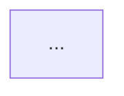

# Prompt Komprehensif untuk Seluruh Gambar Proposal Penelitian

Gunakan prompt ini di ChatGPT untuk membuat seluruh paket gambar/diagram yang dibutuhkan dalam proposal disertasi.

Lampirkan proposal:

- `Proposal_Disertasi_23032026.docx`

Jika proposal tidak terbaca, ChatGPT harus berhenti dan meminta file proposal diunggah ulang.

---

## Prompt Utama

Anda adalah tim ahli visualisasi akademik, metodologi penelitian pendidikan vokasi, pengembangan kurikulum berbasis kompetensi, DACUM, sistem rekomendasi, dan evaluasi produk pendidikan.

Baca proposal disertasi yang saya lampirkan secara menyeluruh. Proposal ini berjudul:

**"Pengembangan Sistem Rekomendasi Kompetensi Bidang Rekayasa Perangkat Lunak Berdasarkan Analisis Kebutuhan Pasar Tenaga Kerja"**

Tugas Anda adalah menyusun **seluruh paket gambar/diagram akademik yang dibutuhkan dalam proposal penelitian**, dengan mindset bahwa penelitian ini akan selesai dan menghasilkan **produk sistem rekomendasi kompetensi yang matang, tervalidasi, dan siap digunakan secara resmi dalam konteks yang memenuhi syarat**.

Jangan membuat gambar berdasarkan kondisi pipeline eksperimen saat ini. Jangan menggambarkan sistem sebagai prototipe yang sedang diuji coba, kumpulan skrip, debugging pipeline, atau proses teknis mentah. Gambar harus melihat ke depan: **produk akhir yang diharapkan setelah penelitian selesai, validasi ahli lulus, korpus Indonesia valid, pemetaan resmi terkonfirmasi, dan evaluasi sistem selesai**.

Namun, tetap jangan menggambarkan sistem sebagai mesin otomatis yang memutuskan kurikulum sendiri. Sistem adalah **sistem rekomendasi dan evidence package** yang membantu ahli dan institusi mengambil keputusan kurikulum berbasis bukti.

---

## Mindset Future-State yang Wajib Dipakai

Dalam semua gambar, asumsikan bahwa produk akhir penelitian memiliki karakter berikut:

1. sistem sudah dapat digunakan oleh institusi pendidikan, pengembang kurikulum, ahli kurikulum, praktisi industri, dan pemangku kepentingan;
2. sistem dapat menghasilkan rekomendasi kompetensi bidang RPL/TI berbasis bukti pasar kerja;
3. setiap rekomendasi memiliki evidence package, status rekomendasi, pemetaan kurikulum/okupasi, dan alasan pemeringkatan;
4. rekomendasi tidak hanya berupa daftar skill, tetapi berupa **competency statement** yang sesuai prinsip CBET;
5. sistem mengadaptasi DACUM menjadi digital DACUM berbasis bukti pasar kerja;
6. sistem mendukung pemetaan ke KKNI, SKKNI, Spektrum Keahlian, okupasi, dan dokumen kurikulum;
7. sistem menyediakan dashboard publik, dashboard administratif, worksheet DACUM/CBET, coverage analyzer, dan export laporan;
8. sistem sudah memiliki tata kelola validasi ahli, evaluasi teknis, evaluasi usability, stability/ablation, dan pass/fail report;
9. status `official_ready` hanya muncul sebagai hasil akhir dari tata kelola validasi, bukan hasil langsung dari AI;
10. keputusan kurikulum akhir tetap dilakukan oleh manusia/institusi.

Gunakan istilah "produk akhir", "sistem operasional", "rekomendasi tervalidasi", "bahan telaah kurikulum", "paket bukti", "pengembang kurikulum", "ahli dan praktisi", "konteks Indonesia", dan "keputusan berbasis bukti".

---

## Bahasa dan Gaya Visual

Gunakan Bahasa Indonesia akademik yang mudah dipahami pembaca pendidikan vokasi.

Jangan gunakan istilah teknis sebagai label utama:

- JSONL;
- CSV;
- HDBSCAN;
- SBERT;
- OpenRouter;
- API;
- embedding;
- prompt;
- Python script;
- provider LLM;
- model checkpoint.

Jika istilah teknis diperlukan, letakkan sebagai catatan kecil, bukan label utama.

Gunakan padanan berikut:

| Istilah teknis | Label akademik dalam gambar |
|---|---|
| raw CSV | Korpus lowongan kerja |
| prepared sentences | Kalimat lowongan yang diproses |
| Skill-LLM extraction | Ekstraksi bukti kompetensi |
| post-extraction typing | Klasifikasi jenis bukti |
| clustering | Pengelompokan tema kompetensi |
| evidence-bound generation | Perumusan kompetensi berbasis bukti |
| grounding gate | Pemeriksaan kesesuaian bukti |
| anti-hallucination filter | Pengendalian halusinasi |
| deduplication | Penggabungan rekomendasi sejenis |
| ranking | Pemeringkatan prioritas |
| recommendation contract | Status kelayakan rekomendasi |
| evidence package | Paket bukti |
| validation package | Paket validasi |
| dashboard | Antarmuka telaah |
| official_ready | Siap dipertimbangkan sebagai rekomendasi resmi |

Gaya visual:

1. formal, bersih, dan akademik;
2. latar putih;
3. warna utama biru tua, abu-abu, putih, dan satu warna aksen;
4. bentuk kotak, panah, swimlane, matriks, atau layered architecture;
5. teks besar, ringkas, dan mudah dibaca saat dicetak A4;
6. hindari ikon berlebihan, ilustrasi kartun, 3D, gradient dekoratif, dan foto stok;
7. gambar harus bisa dibuat ulang di Mermaid, draw.io, Figma, PowerPoint, atau SVG.

---

## Aturan Keras Panah dan Domain

Semua diagram wajib mengikuti aturan ini:

1. alur utama bergerak kiri ke kanan;
2. alur validasi/gate boleh atas ke bawah;
3. panah putus-putus hanya untuk feedback, revisi, atau iterasi;
4. dashboard tidak boleh menjadi sumber validitas;
5. LLM tidak boleh langsung menuju kurikulum final atau status official;
6. korpus US/non-Indonesia tidak boleh menuju klaim kurikulum Indonesia;
7. rekomendasi official harus melewati validasi ahli dan tata kelola resmi;
8. output sistem adalah bahan telaah kurikulum, bukan kurikulum final otomatis;
9. CBET dan DACUM adalah fondasi/kerangka, bukan output dari AI;
10. validasi manusia harus tampak sebagai bagian dari produk akhir.

Koneksi yang dilarang:

| Koneksi terlarang | Alasan |
|---|---|
| LLM -> Kurikulum final | LLM hanya alat bantu perumusan/ringkasan |
| Dashboard -> Validitas rekomendasi | Dashboard hanya antarmuka telaah |
| Korpus US -> Official-ready Indonesia | Korpus US hanya engineering validation |
| Ranking demand -> Official-ready | Ranking perlu validasi ahli dan bukti resmi |
| Usability dashboard -> Validitas kompetensi | Usability hanya mengukur antarmuka |
| AI pipeline -> Keputusan kurikulum otomatis | Keputusan tetap oleh manusia/institusi |

---

## Output Umum yang Diminta

Buat paket gambar untuk proposal. Untuk setiap gambar, berikan:

1. nomor gambar;
2. judul gambar;
3. lokasi bab/subbab yang disarankan;
4. tujuan gambar;
5. pesan utama;
6. elemen visual wajib;
7. struktur layout;
8. node yang harus ada;
9. panah yang harus ada;
10. panah yang dilarang;
11. caption akademik;
12. Mermaid draft jika cocok;
13. deskripsi layout PowerPoint/draw.io/Figma;
14. prompt visual renderer;
15. catatan agar gambar tidak keliru secara akademik.

Sebelum membuat gambar, buat ringkasan daftar seluruh gambar dengan prioritas:

- **Wajib**: harus ada agar proposal jelas.
- **Direkomendasikan**: sangat membantu, tetapi bisa dipilih sesuai ruang.
- **Opsional**: hanya jika proposal memerlukan detail tambahan.

---

# Paket Gambar yang Harus Dibuat

Berikut gambar-gambar yang perlu disusun berdasarkan struktur proposal. Gunakan daftar ini sebagai baseline. Anda boleh menambah gambar jika benar-benar diperlukan, tetapi jangan mengurangi gambar wajib.

---

## Gambar 1. Peta Masalah dan Peran Produk Rekomendasi Kompetensi

**Prioritas:** Wajib  
**Lokasi:** Bab I, Latar Belakang Masalah  
**Orientasi:** Produk akhir sebagai solusi masalah, bukan pipeline teknis.

### Pesan utama

Masalah mismatch kompetensi lulusan dan kebutuhan industri dapat dibantu dengan sistem rekomendasi kompetensi berbasis bukti yang menyajikan kompetensi prioritas untuk telaah kurikulum.

### Struktur visual

Gunakan diagram sebab-solusi-output.

Alur wajib:

`Mismatch kompetensi -> Kebutuhan penyelarasan kurikulum -> Bukti pasar kerja -> Sistem rekomendasi kompetensi -> Bahan telaah/revisi kurikulum`

Tambahkan konteks pendukung:

- Kurikulum Merdeka/KSP;
- kebutuhan dunia kerja;
- RPL/TI sebagai bidang target;
- validasi ahli sebagai pengaman.

### Jangan lakukan

Jangan menampilkan AI sebagai solusi tunggal. Jangan memakai label terlalu teknis.

### Caption

Gambar 1. Peta masalah penyelarasan kompetensi dan peran sistem rekomendasi berbasis bukti dalam mendukung telaah kurikulum bidang RPL/TI.

---

## Gambar 2. Model Produk Akhir Sistem Rekomendasi Kompetensi Berbasis Bukti

**Prioritas:** Wajib  
**Lokasi:** Bab I atau Bab III, Deskripsi Produk  
**Orientasi:** Visual utama produk final.

### Pesan utama

Produk akhir mengintegrasikan sumber bukti, mesin rekomendasi, tata kelola validasi, antarmuka telaah, dan output untuk pengembangan kurikulum.

### Struktur visual wajib: lima zona kiri ke kanan

1. **Sumber Bukti**
   - korpus lowongan kerja Indonesia;
   - dokumen KKNI/SKKNI/Spektrum;
   - dokumen kurikulum institusi;
   - masukan ahli dan praktisi.

2. **Mesin Rekomendasi Kompetensi**
   - audit validitas korpus;
   - ekstraksi bukti kompetensi;
   - pengelompokan tema;
   - perumusan competency statement;
   - pemeriksaan bukti;
   - pemeringkatan demand-first;
   - pemetaan kurikulum/okupasi.

3. **Tata Kelola Validasi**
   - review ahli kurikulum;
   - review praktisi industri;
   - review ahli NLP/AI;
   - review ahli evaluasi;
   - Delphi/expert panel;
   - stability/ablation;
   - recommendation contract.

4. **Antarmuka Produk**
   - dashboard publik;
   - dashboard administratif;
   - evidence package;
   - worksheet DACUM/CBET;
   - coverage analyzer;
   - export laporan.

5. **Output Kurikulum**
   - daftar kompetensi prioritas;
   - status rekomendasi;
   - peta coverage kurikulum;
   - rekomendasi gap;
   - bahan workshop kurikulum;
   - bahan kebijakan terbatas.

### Panah wajib

`Sumber Bukti -> Mesin Rekomendasi Kompetensi -> Tata Kelola Validasi -> Antarmuka Produk -> Output Kurikulum`

Feedback putus-putus:

- `Review ahli -> Mesin Rekomendasi Kompetensi`
- `Umpan balik pengguna -> Antarmuka Produk`
- `Keputusan kurikulum -> Dokumen kurikulum institusi`

### Caption

Gambar 2. Model produk akhir sistem rekomendasi kompetensi berbasis bukti yang mengintegrasikan sumber data, mesin rekomendasi, tata kelola validasi, antarmuka telaah, dan output pengembangan kurikulum.

---

## Gambar 3. Kerangka Teoretis CBET-DACUM dalam Produk Rekomendasi Kompetensi

**Prioritas:** Wajib  
**Lokasi:** Bab II, Kajian Pustaka  
**Orientasi:** Grand theory dan kerangka konseptual, bukan arsitektur software.

### Pesan utama

CBET menentukan bentuk output kompetensi; DACUM menentukan struktur pekerjaan dan tugas; bukti pasar kerja memberi sinyal kebutuhan; validasi ahli menjaga legitimasi kurikulum.

### Struktur visual

Gunakan diagram berlapis.

Lapisan bawah/fondasi:

- CBET/Competency-Based Curriculum;
- DACUM;
- KKNI/SKKNI/Spektrum;
- Human Capital dan Signaling Theory sebagai pendukung.

Lapisan tengah:

- bukti pasar kerja;
- digital DACUM;
- evidence package;
- expert review.

Lapisan atas:

- competency statement;
- rekomendasi kompetensi;
- penyelarasan kurikulum.

### Panah wajib

- `CBET -> Kriteria competency statement`
- `DACUM -> Struktur occupation-duty-task`
- `Bukti pasar kerja -> Evidence package`
- `Expert review -> Legitimasi rekomendasi`
- `Competency statement -> Rekomendasi kurikulum`

### Jangan lakukan

Jangan menempatkan Human Capital Theory sebagai teori utama kurikulum. Jangan menampilkan CBET sebagai hasil pipeline.

### Caption

Gambar 3. Kerangka teoretis produk rekomendasi kompetensi yang menempatkan CBET dan DACUM sebagai fondasi utama, dengan bukti pasar kerja dan validasi ahli sebagai penguat rekomendasi.

---

## Gambar 4. Model Digital DACUM Official-Ready

**Prioritas:** Wajib  
**Lokasi:** Bab II, DACUM Digital atau Kerangka Konseptual  
**Orientasi:** DACUM masa depan yang sudah menjadi mekanisme produk.

### Pesan utama

Produk akhir mengubah prinsip DACUM tradisional menjadi digital DACUM berbasis bukti pasar kerja dan tetap divalidasi oleh ahli.

### Alur wajib

`Okupasi RPL/TI -> Area tugas -> Bukti tugas dari lowongan -> Hard skill/knowledge/soft skill -> Competency statement -> Implikasi kurikulum -> Review ahli -> Rekomendasi tervalidasi`

### Elemen visual

- panel bukti pasar kerja;
- expert worker/praktisi industri;
- ahli kurikulum;
- worksheet DACUM/CBET;
- rekomendasi kompetensi.

### Catatan wajib

Lowongan kerja adalah sumber bukti awal berskala besar, bukan pengganti pekerja ahli.

### Caption

Gambar 4. Model digital DACUM official-ready yang menghubungkan okupasi, area tugas, bukti pekerjaan, keterampilan, pengetahuan, soft skill, competency statement, dan validasi ahli.

---

## Gambar 5. Struktur Competency Statement Berbasis CBET

**Prioritas:** Wajib  
**Lokasi:** Bab II, CBET sebagai Format Output Kompetensi  
**Orientasi:** Menjelaskan bahwa output bukan daftar skill.

### Pesan utama

Kompetensi yang direkomendasikan harus berbentuk pernyataan performa kerja yang observable dan assessable.

### Struktur visual

Gunakan diagram radial atau card anatomy.

Pusat:

- `Competency statement`

Komponen:

- tindakan kerja;
- objek kerja;
- konteks/kondisi;
- kriteria performa;
- bukti lowongan;
- hard skill;
- knowledge;
- soft skill pendukung;
- Bloom/KKNI;
- okupasi/SKKNI/Spektrum.

### Panah wajib

Semua komponen menuju `Competency statement`, lalu menuju `Telaah kurikulum`.

### Jangan lakukan

Jangan jadikan "Python", "SQL", atau "React" sebagai kompetensi langsung. Tools hanya unsur pendukung dalam pernyataan kompetensi.

### Caption

Gambar 5. Struktur competency statement berbasis CBET yang mengintegrasikan tindakan kerja, objek, konteks, kriteria performa, bukti pasar kerja, dan pemetaan jenjang.

---

## Gambar 6. Arsitektur Operasional Produk Final

**Prioritas:** Wajib  
**Lokasi:** Bab III, Deskripsi Produk yang Dikembangkan  
**Orientasi:** Arsitektur target produk, bukan log pipeline sekarang.

### Pesan utama

Produk final memiliki lapisan data, analitik rekomendasi, validasi, aplikasi, dan output kurikulum.

### Struktur visual: layered architecture

Lapisan dari bawah ke atas:

1. **Lapisan Data**
   - korpus lowongan Indonesia;
   - rujukan KKNI/SKKNI/Spektrum;
   - dokumen kurikulum;
   - hasil validasi ahli.

2. **Lapisan Pengolahan Bukti**
   - audit korpus;
   - ekstraksi bukti kompetensi;
   - klasifikasi bukti;
   - pengelompokan tema;
   - pemeriksaan bukti.

3. **Lapisan Rekomendasi**
   - competency statement;
   - demand-first ranking;
   - recommendation status;
   - evidence package.

4. **Lapisan Validasi dan Tata Kelola**
   - expert review;
   - Delphi;
   - stability/ablation;
   - pass/fail report;
   - official readiness gate.

5. **Lapisan Aplikasi**
   - dashboard publik;
   - dashboard administratif;
   - coverage analyzer;
   - worksheet DACUM/CBET;
   - export laporan.

6. **Lapisan Penggunaan**
   - review kurikulum;
   - revisi kurikulum;
   - workshop industri;
   - policy brief terbatas.

### Caption

Gambar 6. Arsitektur operasional produk final yang memperlihatkan lapisan data, pengolahan bukti, rekomendasi, validasi, aplikasi, dan penggunaan dalam pengembangan kurikulum.

---

## Gambar 7. Alur Penggunaan Produk oleh Pengembang Kurikulum

**Prioritas:** Wajib  
**Lokasi:** Bab III, Dashboard/Evidence Package/Coverage Analyzer  
**Orientasi:** User journey produk jadi.

### Pesan utama

Pengembang kurikulum menggunakan sistem untuk memilih konteks, meninjau kompetensi prioritas, memeriksa bukti, membandingkan dengan kurikulum, dan menyusun rekomendasi revisi.

### Alur wajib

`Pilih konteks program/jenjang -> Telusuri kompetensi prioritas -> Buka evidence package -> Periksa status rekomendasi -> Unggah/masukkan dokumen kurikulum -> Lihat coverage dan gap -> Gunakan worksheet DACUM/CBET -> Susun bahan revisi kurikulum`

### Aktor

- guru/dosen/pengembang kurikulum;
- ahli kurikulum;
- praktisi industri;
- admin sistem;
- pemangku kebijakan.

### Jangan lakukan

Jangan menggambarkan pengguna cukup "klik generate kurikulum". Produk tidak menghasilkan kurikulum final otomatis.

### Caption

Gambar 7. Alur penggunaan produk oleh pengembang kurikulum untuk menelaah kompetensi prioritas, memeriksa bukti, menganalisis coverage, dan menyusun bahan revisi kurikulum.

---

## Gambar 8. Status Rekomendasi dan Tata Kelola Official Readiness

**Prioritas:** Wajib  
**Lokasi:** Bab III, Recommendation Contract  
**Orientasi:** Future-state governance.

### Pesan utama

Setiap rekomendasi memiliki status yang menunjukkan tingkat kelayakan klaim, dari exploratory sampai official-ready.

### Decision flow wajib

`Kompetensi kandidat`
-> `Korpus valid dan sesuai klaim?`
-> `Bukti cukup dan grounded?`
-> `Relevan dengan RPL/TI?`
-> `Pemetaan KKNI/SKKNI/Spektrum tepat?`
-> `Validasi ahli lulus?`
-> `Stability/ablation lulus?`
-> `Official-ready`

Cabang:

- gagal lineage: `exploratory`;
- bukti lemah: `not recommended from this corpus`;
- belum validasi ahli: `review candidate`;
- out-of-domain: `out-of-domain/needs review`.

### Catatan wajib

Official-ready bukan output otomatis AI, tetapi hasil tata kelola validasi.

### Caption

Gambar 8. Tata kelola status rekomendasi yang membedakan exploratory, review candidate, official-ready, dan not recommended from this corpus berdasarkan validitas korpus, bukti, pemetaan, validasi ahli, dan stabilitas.

---

## Gambar 9. Peta Evidence Package untuk Satu Rekomendasi Kompetensi

**Prioritas:** Direkomendasikan  
**Lokasi:** Bab III, Evidence Package  
**Orientasi:** Menjelaskan transparansi rekomendasi.

### Pesan utama

Pengguna dapat menelusuri alasan setiap rekomendasi melalui paket bukti yang lengkap.

### Struktur visual

Gunakan card/table anatomy.

Satu `kompetensi prioritas` memiliki:

- competency statement;
- status rekomendasi;
- job prevalence;
- jumlah source jobs;
- evidence sentences;
- related hard skills;
- related knowledge;
- related soft skills;
- KKNI/Bloom;
- SKKNI/Spektrum/okupasi;
- blockers;
- reviewer comments;
- revision history.

### Caption

Gambar 9. Struktur evidence package yang memungkinkan setiap rekomendasi kompetensi ditelusuri dari bukti pasar kerja, pemetaan kurikulum, status rekomendasi, dan catatan validasi ahli.

---

## Gambar 10. Hubungan Sistem dengan Ekosistem Kurikulum Vokasi Indonesia

**Prioritas:** Direkomendasikan  
**Lokasi:** Bab II atau Bab III  
**Orientasi:** Menunjukkan posisi produk dalam sistem pendidikan.

### Pesan utama

Produk tidak berdiri sendiri; produk mendukung ekosistem kurikulum vokasi yang melibatkan sekolah/program studi, industri, rujukan resmi, dan kebijakan.

### Struktur visual

Gunakan ecosystem map.

Pusat:

- `Sistem Rekomendasi Kompetensi`

Lingkaran sekitar:

- institusi pendidikan;
- guru/dosen/pengembang kurikulum;
- praktisi industri;
- ahli kurikulum;
- KKNI;
- SKKNI;
- Spektrum Keahlian;
- korpus lowongan kerja Indonesia;
- peserta didik/lulusan;
- pemangku kebijakan.

### Panah wajib

- bukti pasar kerja -> sistem;
- rujukan resmi -> sistem;
- sistem -> bahan telaah kurikulum;
- ahli/praktisi -> validasi;
- institusi -> keputusan kurikulum.

### Caption

Gambar 10. Posisi sistem rekomendasi kompetensi dalam ekosistem kurikulum vokasi Indonesia yang menghubungkan bukti pasar kerja, rujukan resmi, ahli, industri, dan institusi pendidikan.

---

## Gambar 11. Kerangka Evaluasi Produk Akhir

**Prioritas:** Wajib  
**Lokasi:** Bab II Kerangka Evaluasi atau Bab III Teknik Analisis Data  
**Orientasi:** Menunjukkan bagaimana produk dinilai layak.

### Pesan utama

Produk akhir dievaluasi berlapis: data, ekstraksi, cluster, kompetensi, pemetaan, ranking, usability, coverage, validasi ahli, dan stabilitas.

### Struktur visual

Gunakan pyramid/layered evaluation framework.

Lapisan:

1. validitas korpus dan lineage;
2. kualitas ekstraksi bukti;
3. validitas pengelompokan tema;
4. kualitas competency statement;
5. ketepatan KKNI/SKKNI/Spektrum/okupasi;
6. validitas ranking dan recommendation status;
7. validasi ahli dan Delphi;
8. usability dan usefulness;
9. coverage analyzer;
10. stability/ablation dan pass/fail report.

### Caption

Gambar 11. Kerangka evaluasi berlapis untuk menilai kelayakan produk sistem rekomendasi kompetensi dari sisi data, komputasional, kurikuler, pengguna, dan stabilitas.

---

## Gambar 12. Rancangan Metode R&D Borg and Gall Menuju Produk Final

**Prioritas:** Wajib  
**Lokasi:** Bab III, Rancangan dan Tahapan Penelitian  
**Orientasi:** Metode penelitian, tetapi tetap future-state.

### Pesan utama

Penelitian mengembangkan produk melalui tahapan R&D Borg and Gall, dengan Agile sebagai proses teknis internal, dan validasi/uji coba sebagai dasar revisi sampai produk final.

### Struktur visual

Gunakan timeline atau swimlane.

Alur Borg and Gall:

`Studi pendahuluan -> Perencanaan -> Produk awal -> Uji coba awal -> Revisi utama -> Uji coba utama -> Revisi operasional -> Uji operasional -> Revisi final -> Diseminasi terbatas`

Lane Agile di bawah tahap pengembangan/revisi:

`Rancang -> Bangun -> Uji -> Tinjau -> Revisi`

Lane validasi:

- validasi instrumen;
- validasi ahli;
- Delphi;
- uji pengguna;
- analisis data;
- pass/fail report.

### Jangan lakukan

Jangan membuat Agile menggantikan Borg and Gall. Agile hanya proses teknis internal.

### Caption

Gambar 12. Rancangan metode R&D Borg and Gall yang dipadukan dengan Agile Development sebagai proses teknis internal untuk menghasilkan produk sistem rekomendasi kompetensi yang tervalidasi.

---

## Gambar 13. Peta Instrumen dan Pengukuran Penelitian

**Prioritas:** Wajib  
**Lokasi:** Bab III, Teknik dan Instrumen Pengumpulan Data  
**Orientasi:** Menjelaskan instrumen sebagai lampiran proposal.

### Pesan utama

Setiap aspek produk diukur dengan instrumen dan teknik analisis yang berbeda.

### Struktur visual

Gunakan matrix atau hub-and-spoke.

Kelompok instrumen:

- studi dokumen dan analisis korpus;
- wawancara kebutuhan awal;
- gold labeling sentence relevance;
- gold labeling hard skill/soft skill/knowledge;
- validasi ahli kurikulum CBET/DACUM;
- validasi praktisi industri;
- validasi ahli NLP/AI;
- validasi ahli evaluasi;
- validasi KKNI/SKKNI/Spektrum;
- worksheet DACUM/CBET;
- Delphi/expert panel;
- SUS dan usability;
- coverage analyzer;
- FGD/wawancara pengguna;
- log revisi dan pass/fail report.

Kelompok analisis:

- Aiken's V/CVI/CVR;
- Cohen/Fleiss Kappa;
- precision/recall/F1;
- SUS;
- statistik deskriptif;
- analisis kualitatif;
- stability/ablation.

### Caption

Gambar 13. Peta instrumen dan pengukuran penelitian yang menghubungkan aspek produk, sumber data, validator/responden, dan teknik analisis.

---

## Gambar 14. Alur Validasi Ahli dan Delphi untuk Official Readiness

**Prioritas:** Direkomendasikan  
**Lokasi:** Bab III, Validasi Ahli dan Delphi  
**Orientasi:** Governance produk final.

### Pesan utama

Official readiness membutuhkan validasi ahli berlapis dan konsensus, bukan keputusan otomatis sistem.

### Alur wajib

`Paket review ahli -> Penilaian ahli kurikulum -> Penilaian praktisi industri -> Penilaian ahli NLP/AI -> Penilaian ahli evaluasi -> Rekap validitas dan reliabilitas -> Revisi rekomendasi -> Delphi/konsensus -> Keputusan status rekomendasi`

Keputusan:

- retain;
- revise;
- merge;
- split;
- drop;
- official-ready candidate.

### Caption

Gambar 14. Alur validasi ahli dan Delphi yang menentukan revisi, konsensus, dan status kelayakan rekomendasi kompetensi.

---

## Gambar 15. Coverage Analysis Kurikulum terhadap Kompetensi Prioritas

**Prioritas:** Direkomendasikan  
**Lokasi:** Bab III, Coverage Analyzer atau Manfaat Produk  
**Orientasi:** Salah satu manfaat produk final.

### Pesan utama

Produk membantu institusi membandingkan dokumen kurikulum dengan kompetensi prioritas berbasis bukti.

### Struktur visual

Alur wajib:

`Dokumen kurikulum institusi -> Coverage analyzer -> Kompetensi sudah tercakup -> Kompetensi tercakup sebagian -> Gap kompetensi -> Bahan revisi kurikulum`

Tambahkan evidence package sebagai sumber pembanding.

### Caption

Gambar 15. Alur coverage analysis yang membandingkan dokumen kurikulum institusi dengan kompetensi prioritas untuk menghasilkan peta cakupan dan gap kurikulum.

---

## Gambar 16. Batas Klaim dan Penggunaan Produk

**Prioritas:** Direkomendasikan  
**Lokasi:** Bab III atau bagian batasan/klaim produk  
**Orientasi:** Mencegah overclaim.

### Pesan utama

Produk membantu rekomendasi, tetapi penggunaan resminya bergantung pada konteks korpus, validasi ahli, rujukan resmi, dan kebijakan institusi.

### Struktur visual

Gunakan decision matrix.

Kolom:

- kondisi data;
- status bukti;
- status validasi;
- status pemetaan resmi;
- hasil yang boleh diklaim.

Baris:

- data US/non-Indonesia;
- data Indonesia belum lengkap;
- data Indonesia valid tetapi belum ahli;
- data Indonesia valid + ahli lulus;
- data Indonesia valid + ahli lulus + stabilitas lulus + rujukan resmi.

Output:

- engineering validation;
- exploratory;
- review candidate;
- official-ready candidate;
- official-ready.

### Caption

Gambar 16. Matriks batas klaim penggunaan produk yang membedakan engineering validation, exploratory, review candidate, official-ready candidate, dan official-ready berdasarkan validitas data, bukti, pemetaan, validasi, dan stabilitas.

---

# Format Output untuk Setiap Gambar

Untuk setiap gambar, tuliskan dalam format berikut:

```markdown
## Gambar X. [Judul]

**Prioritas:** Wajib/Direkomendasikan/Opsional  
**Lokasi proposal:** Bab/Subbab ...  
**Fungsi dalam proposal:** ...

### Pesan utama
...

### Struktur visual
...

### Node wajib
- ...

### Panah wajib
- ...

### Panah/koneksi yang dilarang
- ...

### Caption akademik
Gambar X. ...

### Mermaid draft


### Deskripsi layout PowerPoint/draw.io/Figma
...

### Prompt visual renderer
Academic dissertation diagram, clean white background, navy and gray palette, Indonesian academic labels, ...

### Catatan anti-keliru
- ...
```

---

# Output Akhir yang Harus Diberikan

Berikan hasil dalam urutan:

1. daftar seluruh gambar yang disarankan;
2. prioritas dan lokasi gambar dalam proposal;
3. tabel ringkas fungsi setiap gambar;
4. detail lengkap setiap gambar sesuai format di atas;
5. Mermaid draft untuk gambar yang cocok;
6. prompt visual renderer untuk setiap gambar;
7. rekomendasi format produksi: Mermaid, draw.io, Figma, PowerPoint, SVG, atau PNG;
8. checklist konsistensi visual;
9. checklist konsistensi klaim agar gambar tidak overclaim.

Jika jawaban terlalu panjang, bagi menjadi beberapa bagian dan lanjutkan sistematis. Jangan menghapus gambar wajib hanya karena jawaban panjang.

---

# Checklist Konsistensi Klaim

Sebelum mengakhiri jawaban, pastikan:

1. semua gambar melihat ke depan sebagai produk final/official-ready yang diharapkan;
2. tidak ada gambar yang menggambarkan pipeline saat ini sebagai kondisi akhir;
3. tidak ada gambar yang menjadikan AI/LLM sebagai pengambil keputusan kurikulum;
4. dashboard selalu digambarkan sebagai antarmuka telaah;
5. CBET dan DACUM tampak sebagai fondasi konseptual;
6. expert review dan validasi manusia tampak sebagai tata kelola produk;
7. official-ready muncul sebagai hasil validasi dan tata kelola, bukan output langsung sistem;
8. output sistem disebut sebagai bahan telaah/rekomendasi, bukan kurikulum final otomatis;
9. bahasa label ramah pembaca pendidikan vokasi;
10. arah panah dan domain tidak membingungkan.
